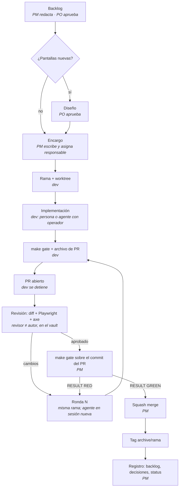

# VERDE · Vault-Driven Development

**Versión 1.0 · 2026-11-11 · © 2026 Javier Batres · CC BY 4.0**

VERDE es un framework para desarrollar aplicaciones con agentes de IA en un
equipo con roles fijos. Su nombre resume la regla: **nada avanza si no está en
verde**. Las letras son sus cinco pilares:

| | Pilar | En inglés | En una frase |
| --- | --- | --- | --- |
| **V** | Vault | Vault | La memoria del proyecto vive fuera del código y del chat. |
| **E** | Encargo | Engagement brief | Todo trabajo entra por escrito, con alcance y evidencia esperada. |
| **R** | Revisión | Review | El revisor ve la aplicación funcionando, no sólo el diff. |
| **D** | Decisión | Decision | Toda decisión se numera, se fecha y tiene un estado. |
| **E** | Evidencia | Evidence | Nada se integra sin la puerta de checks en `RESULT GREEN`. |

Al método se le llama también **VDD (Vault-Driven Development)**, al estilo de
TDD o BDD: en TDD la prueba va primero; en VDD, el vault. Lo que no está en el
vault no se decidió, y lo que no tiene evidencia no está hecho.

---

## 1. Principios

1. **El vault manda.** Si no está en el vault, no se decidió. El chat se
   olvida; el vault no.
2. **Todo trabajo entra por encargo.** Nadie, persona o agente, recibe
   "arregla esto" en el chat: recibe un archivo con objetivo, alcance y
   criterios.
3. **Quien entrega escribe la evidencia.** El revisor verifica lo escrito en vez
   de redescubrirlo.
4. **El revisor ve la aplicación.** Un cambio de UI no se aprueba leyendo código.
5. **La puerta decide el merge.** Ni la confianza ni la prisa: `RESULT GREEN`.
6. **Toda decisión se numera.** `D-xxx`, con fecha, origen y estado. No se
   borra: se reemplaza.
7. **Causas, no síntomas.** No se agregan reintentos ni se cambia un diseño para
   callar un check.
8. **Una sesión por encargo, un agente por worktree.** El estado vive en la rama
   y en el archivo de PR, no en la conversación.
9. **Los roles no son herramientas.** Un rol puede ocuparlo una persona o un
   agente; el método no cambia.
10. **Quien escribe no aprueba.** El revisor de una entrega nunca es su autor.
11. **Todo agente tiene un humano responsable.** Un agente trabaja bajo un
    operador que lo lanza, lo vigila y responde por su entrega.

## 2. Los cinco pilares

### V · Vault

**Qué es:** un repositorio de notas en Markdown (pensado para Obsidian, sirve
cualquier editor) con el producto, el backlog, los encargos, las revisiones,
las reuniones, las decisiones y el status del proyecto.

**Dónde vive:** en **su propio repo git privado** (`<proyecto>-vault`),
clonado al lado del repo de código. No va dentro del repo de código: tiene
otro ritmo, otros autores y otro nivel de confidencialidad.

**Quién lo escribe:** el PO, el PM y los revisores, con commit y push directo
a `main`. Los devs lo **leen**: los agentes, por la ruta de su `AGENTS.md`; las
personas, con su propio clon. Si un dev necesita cambiar algo del vault (una
decisión, un criterio), lo propone en su archivo de PR y quien escribe el vault
lo registra.

**Regla mínima:** cada encargo, revisión, reunión y decisión es una nota del
vault, creada desde su plantilla.

**Anti-patrón:** "lo hablamos en el chat". Si un agente necesita algo que sólo
está en una conversación, la próxima sesión no lo sabrá.

### E · Encargo

**Qué es:** el documento que recibe el dev, sea persona o agente. Es lo
**único** que necesita, junto con `AGENTS.md`. Cada encargo tiene **un
responsable**: un dev humano o un agente con su operador.

**Dónde vive:** `03-Encargos/` del vault.

**Quién lo escribe:** el PM; el PO lo aprueba cuando el encargo cambia alcance
o producto.

**Regla mínima:** un encargo tiene:

- origen (quién lo pidió y qué decisión lo respalda);
- rama y worktree;
- criterios **verificables**, cada uno con la evidencia esperada;
- alcance cerrado (qué sí, qué no, si hay migraciones o dependencias nuevas);
- entorno (si puede levantar Docker);
- fuera de alcance explícito;
- qué hacer si se bloquea: escribir la pregunta y detenerse.

**Anti-patrón:** el encargo que dice el síntoma sin pedir la causa. El agente
resolverá el síntoma (ver sección 12).

### R · Revisión

**Qué es:** la verificación de un PR, escrita en el vault.

**Dónde vive:** `06-Revisiones/`, una nota por PR y ronda.

**Quién la escribe:** un revisor que **no es el autor**. En un equipo pequeño
es el PM; en uno grande, el PM asigna revisores. Un agente puede revisar, pero
la aprobación final la firma una persona con rol de revisor o PM.

**Regla mínima:**

- se verifica cada criterio contra la evidencia;
- si hay UI, se abre la aplicación con **Playwright**, se recorre el flujo, se
  toman capturas y se corre **axe**;
- cada hallazgo lleva archivo y severidad: **bloqueante**, **mayor**, **menor**
  o **nota**;
- las notas menores pueden ir a un encargo de mantenimiento para no gastar una
  ronda.

**Anti-patrón:** aprobar leyendo el diff. Los problemas de UI (contraste, un
botón fuera de lugar, un estado vacío roto) no se ven en el código.

**Contrapeso:** el revisor también se equivoca. El dev puede contradecir la
revisión con evidencia y eso es parte del proceso.

### D · Decisión

**Qué es:** el registro numerado de lo que se decidió.

**Dónde vive:** `04-Decisiones/Registro-de-decisiones.md` en el vault; las
técnicas, además, como ADR en `docs/adr/` del repo, y un índice en
`docs/decisions.md`.

**Quién la escribe:** el PM, el mismo día, con origen (reunión, encargo,
revisión) y aprobación del PO.

**Regla mínima:** `D-xxx` consecutivo y nunca reutilizado, con estado:

| Estado | Significa |
| --- | --- |
| ✅ vigente | Se aplica hoy. |
| 🔁 reemplazada | Otra decisión la sustituye y la cita. |
| ⏸️ en pausa | Sigue siendo válida, pero no se aplica hasta nuevo aviso. |
| ⏳ pendiente | Se identificó, falta decidir. |

El código, los encargos y los PR citan decisiones por ID.

**Anti-patrón:** borrar o reescribir una decisión vieja. Se pierde el porqué.

### E · Evidencia

**Qué es:** la **puerta**, un único comando (`make gate`) que corre todos los
checks y responde verde o rojo, más el archivo de PR con la evidencia de cada
criterio.

**Dónde vive:** `tools/ci/local-gate.sh` y `gate.steps` en el repo;
`docs/prs/<KEY>-<n>-<slug>.md` para cada PR.

**Quién la produce:** el dev la corre antes de abrir el PR; quien integra la
vuelve a correr sobre el commit exacto antes del merge.

**Regla mínima:** formato, lint, pruebas, build, cobertura (≥ el umbral del
proyecto, 80 % por defecto), e2e y seguridad. La salida es siempre la misma:

```text
head 3f2a9c1 · 2026-11-11 10:42:07
PASS format
PASS lint
PASS test
PASS build
PASS coverage
PASS infra
PASS e2e
PASS infra-down
SKIP snyk
RESULT GREEN · log tmp/gate.log
```

**Anti-patrón:** "en mi máquina pasa". Si no hay salida de la puerta pegada en
el PR, no hay evidencia.

## 3. Roles

Un rol es una responsabilidad, no una persona ni una herramienta. Una misma
persona puede tener varios roles (en un equipo pequeño, el PM suele ser también
revisor), con una sola excepción: **nadie revisa su propia entrega**.

| Rol | Responsabilidad | Persona o agente | Qué no hace |
| --- | --- | --- | --- |
| **PO** | Decide qué se construye y por qué. Aprueba backlog, diseños, encargos que cambian alcance y entregas. Decide lo abierto. | Persona | — |
| **PM** | Escribe backlog, encargos, decisiones y status en el vault. Asigna encargos y revisores. Integra (squash merge) cuando la revisión está aprobada y la puerta en verde. | Persona o agente | Integrar sin aprobación o con la puerta en rojo. |
| **Revisor** | Verifica cada entrega contra sus criterios, revisa en vivo con Playwright y escribe la revisión. | Persona o agente (la aprobación final, una persona) | Revisar lo que escribió. |
| **Dev** | Implementa un encargo en su rama, escribe la evidencia y abre el PR. | Persona o agente | Merge, push a `main`, `--force`, `--no-verify`, tocar fuera de su alcance. |
| **Operador** | Lanza agentes dev con su encargo, los vigila, los destraba y responde por lo que entregan. | Persona | Dejar un agente sin supervisión o con permisos fuera de su worktree. |
| **Arquitecto** (opcional) | Diseños y ADR que bloquean el trabajo que depende de ellos. Si no hay, lo cubre el PM. | Persona o agente | — |

### Los desarrolladores

En VERDE, un **desarrollador humano** normalmente trabaja como **operador**:
recibe uno o varios encargos, los lanza con agentes, los vigila y responde por
lo que entregan. También puede **escribir código él mismo**; en ese caso es el
dev de su encargo y sigue exactamente el mismo ciclo:

- trabaja desde un encargo del vault, en su propia rama;
- corre `make gate` y escribe el archivo de PR con la evidencia;
- su PR lo revisa otra persona o un agente, con aprobación final de una persona.

Que el código lo escriba una persona o un agente no cambia nada del proceso: la
evidencia y la revisión son las mismas. Lo que sí cambia es quién responde: el
operador por sus agentes, el dev humano por su propio código.

El operador:

- elige el agente y el modelo adecuados al encargo (los encargos chicos y
  exactos admiten modelos pequeños; los de diseño o seguridad, no);
- prepara la worktree y el entorno, y lanza el agente con el encargo;
- vigila sin intervenir en el contenido: si el agente se bloquea por algo que
  el encargo no decide, la pregunta va al PM, no se improvisa;
- revisa que la entrega esté completa (evidencia, puerta en verde) antes de
  pedir revisión. No es la revisión: es asegurarse de que el PR está listo.

## 4. El ciclo



1. **Backlog.** El PM redacta épicas, issues y criterios verificables. El PO
   aprueba.
2. **Diseño.** Si hay pantallas nuevas, se diseñan y el PO las aprueba antes de
   implementar.
3. **Encargo.** El PM lo escribe desde la plantilla y lo asigna a un
   responsable: un dev humano o un operador con su agente.
4. **Rama y worktree.** El dev crea `feat/<KEY>-<n>-<slug>` desde `main` en una
   worktree propia.
5. **Implementación.** Commits `<KEY>-<n>: <imperativo>`.
6. **Evidencia.** El dev corre `make gate`, escribe el archivo de PR y abre el
   PR. Se detiene.
7. **Revisión.** Un revisor que no es el autor verifica criterios, revisa en
   vivo y escribe la revisión.
8. **Rondas.** Si hay cambios, el dev los hace en la misma rama (un agente, en
   una **sesión nueva**) y agrega "Round N" al archivo de PR.
9. **Merge.** El PM corre la puerta sobre el commit del PR, pega la salida en el
   PR y hace squash merge con `--match-head-commit`. La rama se archiva como tag
   `archive/<rama>` y se borra.
10. **Registro.** El PM actualiza backlog, decisiones y status del día.

## 5. Equipos de varios integrantes

VERDE funciona igual con tres integrantes que con quince. Al crecer el equipo
se agregan estas reglas:

- **Un encargo, un responsable.** Cada encargo tiene un solo dev o un solo
  operador. El backlog muestra quién lo tiene; nadie toma un encargo asignado.
- **Límite de trabajo en curso.** Cada operador vigila a la vez sólo los agentes
  que puede seguir de verdad (dos o tres es lo habitual). Cada dev humano tiene
  un encargo en curso, más los que esperan revisión.
- **Revisión cruzada.** El PM asigna los revisores. Autor y revisor son
  siempre distintos, y nunca dos agentes del mismo operador se aprueban entre sí.
- **Un vault, un registro.** Todo el producto comparte un vault y una sola
  numeración de decisiones, aunque haya varios equipos. Si hay varios PM, cada
  uno escribe los encargos de su área y todos registran en el mismo
  `Registro-de-decisiones.md`.
- **Áreas sin solaparse.** Los encargos que corren en paralelo no tocan los
  mismos módulos. Si es inevitable, se ordenan: uno se integra y el otro parte
  de `main` actualizado.
- **Entornos separados.** Cada dev u operador tiene su entorno local; los
  agentes que comparten máquina se turnan los puertos o usan entornos aislados.
- **Una sola cola de integración.** Sólo el PM (o los integradores que él
  designe) hace merge, de a uno, siempre con la puerta corrida sobre el commit
  exacto.
- **Status diario.** El status del día en el vault reúne qué entró, qué está en
  curso, qué está bloqueado y quién tiene cada cosa.

## 6. Cómo se ve en la práctica

**Equipo mínimo: un PO, un PM y agentes.** El PO decide la prioridad del día.
El PM, que también revisa, escribe dos encargos. El PO hace de operador: lanza
un agente por encargo, cada uno en su worktree, y vigila sus terminales. Cuando
un agente abre su PR, el PM lo revisa en vivo, pide una ronda o lo aprueba,
corre la puerta e integra. Al final del día el PM actualiza backlog, decisiones
y status.

**Equipo de seis: un PO, un PM y cuatro devs.**

1. Por la mañana el PO y el PM confirman prioridades. El PM ya tiene seis
   encargos listos en el vault, de áreas distintas, y los asigna.
2. Tres devs operan agentes: cada uno lanza dos agentes con sus encargos y los
   vigila. El cuarto dev escribe a mano un encargo delicado (una migración de
   datos) porque prefiere hacerlo él.
3. A media mañana un agente se bloquea: el encargo no dice si un campo es
   obligatorio. Su operador no lo decide: lo pregunta al PM, que lo resuelve
   con el PO, registra `D-087` y actualiza el encargo. El agente sigue en una
   sesión nueva.
4. Cada PR que se abre lo revisa alguien que no lo escribió. El PR del dev que
   programó a mano lo revisa otro dev, con un agente como apoyo para la revisión
   en vivo. Los PR de los agentes los revisan el PM o un dev de otra área.
5. El PM integra en orden: puerta sobre el commit exacto, squash y tag de
   archivo. Si dos PR tocan lo mismo, integra uno y pide al otro actualizar su
   rama.
6. Al cierre, el status del día muestra lo integrado, lo que está en revisión y
   lo bloqueado, con su responsable.

## 7. Convenciones

| Qué | Formato | Ejemplo |
| --- | --- | --- |
| Clave de issue | `<KEY>-<n>` | `ACME-42` |
| Rama de trabajo | `feat/<KEY>-<n>-<slug>` | `feat/ACME-42-login` |
| Rama de mantenimiento | `maint/<KEY>-<n>-<slug>` | `maint/ACME-57-flaky-e2e` |
| Commit | `<KEY>-<n>: <imperativo>` (< 72 caracteres, sin punto) | `ACME-42: Add email login form` |
| Título de PR | igual que un commit | `ACME-42: Email login` |
| Archivo de PR | `docs/prs/<KEY>-<n>-<slug>.md` | `docs/prs/ACME-42-login.md` |
| Decisión | `D-xxx` | `D-017` |
| ADR | `docs/adr/NNNN-<tema>.md` | `docs/adr/0003-auth.md` |
| Rama archivada | tag `archive/<rama>` | `archive/feat/ACME-42-login` |
| Encargo | `03-Encargos/<KEY>-<n>-<agente>-<tema>.md` | `ACME-42-dev-login.md` |
| Revisión | `06-Revisiones/<KEY>-<n>-revision.md` | `ACME-42-revision.md` |
| Severidad | bloqueante · mayor · menor · nota | — |

Un grupo de issues que se entrega en un solo PR puede tener su propia clave.
Llámalo como prefieras (historia, entrega, *carrier*); el método no lo exige.

Sólo se integra con **squash**: una entrega, un commit en `main`.

## 8. La puerta

La puerta es el pilar que hace cumplir a los demás. Se implementa con dos
archivos de la plantilla de repo:

- `tools/ci/local-gate.sh`, que no conoce tu stack;
- `gate.steps`, donde declaras los pasos:

```text
# <kind> <name>: <command>
step format: npx prettier --check .
step lint: npm run lint
step test: npm test
setup infra: docker compose up -d --wait
step e2e: npx playwright test
teardown infra-down: docker compose down
step ?snyk: snyk test --severity-threshold=high
```

- **`setup`** y **`step`** corren en el orden del archivo: pon cada `setup`
  antes de los pasos que lo necesitan. Si un `setup` falla, se saltan los pasos
  siguientes y el resultado es rojo.
- Un **`step`** corre aunque uno anterior haya fallado, para ver todos los
  problemas en una corrida.
- **`teardown`** corre siempre, al final.
- **`?nombre`** marca un paso opcional: si la herramienta no está instalada, da
  `SKIP`. Úsalo para servicios con límites o licencias (escáneres de seguridad
  en la nube), nunca para callar un paso obligatorio.

El código de salida es 0 (verde), 1 (rojo) o 2 (`gate.steps` mal escrito). El
log completo queda en `tmp/gate.log`.

**Cualquier stack.** El ejemplo es Node, pero el script sólo ejecuta los
comandos que declares. La plantilla trae bloques comentados para Python, Go,
Java, .NET y monorepos; deja activo el que corresponda.

**Sistemas operativos.** La puerta necesita `bash` y `make`. En macOS y Linux
ya vienen. En Windows, usa WSL (con `make` instalado) o Git Bash; Git Bash no
trae `make`, así que ahí se corre `bash tools/ci/local-gate.sh`. Los comandos
de cada paso deben existir en ese mismo entorno.

**CI remota.** El workflow `ci.yml` corre la misma puerta. Cuando la CI remota
no está disponible (facturación, límites de un servicio externo), **manda la
puerta local**: el PM la corre y pega la salida en el PR. La CI remota es un
espejo, no otra fuente de verdad.

**Pruebas intermitentes.** Si un paso falla sin relación con el diff y pasa al
correrlo solo, se permite **una** re-ejecución de ese paso para el merge, se
anota en el PR y se abre un encargo de causa raíz. Nunca se agregan reintentos
ni se suben timeouts para taparlo.

## 9. Día 0 de un proyecto nuevo

- [ ] Crear el repo del vault desde `templates/vault/` y el repo de código desde
      `templates/repo/`, ambos privados, clonados uno al lado del otro.
- [ ] Elegir la clave de issues (`<KEY>`) y reemplazar los marcadores `<…>`
      (`grep -rn '<[A-Z]' .`).
- [ ] Registrar **D-001 · Adoptamos VERDE / VDD v1.0** y las decisiones de
      arranque (stack, alcance, quién ocupa cada rol).
- [ ] Ajustar `gate.steps` al stack y correr `make gate` hasta `RESULT GREEN`
      con el esqueleto del proyecto.
- [ ] Asignar los roles: PO, PM, revisores, devs y operadores. Anotarlos en
      `00-Inicio.md` del vault y en `AGENTS.md`.
- [ ] Completar `AGENTS.md`: proyecto, ruta del vault, roles, comandos.
- [ ] En GitHub (o equivalente):
  - definir la variable de repo `ISSUE_KEY`;
  - proteger `main` con PR obligatorio, squash only, el check `gate` requerido
    y sin push directo;
  - cargar los secretos de la CI.
- [ ] Dar acceso a los dos repos a cada persona del equipo.
- [ ] Escribir el backlog de la primera entrega y el primer encargo.
- [ ] Lanzar el primer agente en su worktree y revisar el primer PR con el ciclo
      completo, aunque sea pequeño: así se prueba el proceso antes que el
      producto.

## 10. Higiene de contexto para agentes

Cada paso de un agente vuelve a leer toda la conversación, así que casi todo
el consumo de tokens es relectura, y unas pocas sesiones largas concentran la
mayor parte. Por eso:

- **Una sesión nueva por encargo y por ronda.** El estado vive en la rama y en
  el archivo de PR.
- **Salidas filtradas** (`tail`, `grep`). Nunca pegar logs completos; la puerta
  ya guarda el log.
- **Esperar la CI con un comando que bloquea** (`gh pr checks <n> --watch`),
  nunca con un bucle de consultas.
- **Encargos pequeños.** Un encargo cerrado sale en una ronda; una épica grande
  se divide en partes que se puedan revisar por separado.
- **Modelos pequeños o locales** sirven para cambios de pocos archivos con
  instrucciones exactas, no para diseñar.

## 11. Lanzar un agente

```sh
git worktree add ../<proyecto>-<KEY>-<n> -b feat/<KEY>-<n>-<slug> origin/main
cd ../<proyecto>-<KEY>-<n>
<agente> "Lee AGENTS.md y el encargo ../<proyecto>-vault/03-Encargos/<archivo>.md. Haz el encargo completo."
```

- Un agente por worktree. Los permisos amplios (sin pedir aprobación por
  comando) sólo dentro de su worktree y con un encargo cerrado.
- La worktree nueva no trae archivos ignorados (`.env`): cópialos o deja que el
  agente los cree desde `.env.example`.
- Si dos agentes necesitan el mismo entorno con puertos fijos, se turnan. Dos
  stacks a la vez fallan de formas que parecen bugs.
- El operador vigila la terminal del agente; otro revisa el resultado. Separar
  esas dos tareas evita que el revisor se vuelva coautor.

## 12. Lecciones

Lo que cuesta ignorar estas reglas:

- **El agente resuelve el síntoma si el encargo no pide la causa.** Ante un check
  de contraste que falla en un botón primario, el agente puede cambiarlo a
  secundario y el check pasa, aunque la causa sea otra (por ejemplo, una
  transición CSS que el test mide a la mitad).
- **La evidencia escrita ahorra la mitad de la revisión.** Con comandos y
  salidas en el archivo de PR, revisar es verificar.
- **Diseño antes que código.** Con las pantallas aprobadas antes de
  implementar, los cambios llegan como pulido, no como rediseño.
- **Las pruebas intermitentes casi siempre son de orden o de tiempo:** filas
  creadas en la misma transacción con la misma marca de tiempo, el día que
  cambia a mitad del e2e, un timeout corto bajo carga. Se arreglan en la prueba
  o en el código.
- **Las dependencias externas de la CI frenan sin que haya un error:** la
  facturación de la CI o el límite mensual de un escáner. La puerta local evita
  que eso detenga el trabajo.
- **Dos entornos a la vez fallan como si fueran bugs.** Un puerto ocupado por
  otra instancia hace fallar el e2e. La puerta debe verificar sus
  precondiciones antes de empezar.
- **Menos agentes, más estables.** Un solo dev y un PM que revisa dan un flujo
  más predecible que varios agentes en roles parecidos.
- **Integrar sólo con squash.** Un merge commit ensucia la historia
  de `main` para siempre.

## 13. Glosario

| Español | Inglés | Qué es |
| --- | --- | --- |
| Vault | Vault | Repo de notas con la memoria del proyecto. |
| Encargo | Engagement brief | Documento de trabajo para un agente. |
| Revisión | Review | Verificación escrita de un PR, con revisión en vivo. |
| Decisión | Decision | Entrada numerada `D-xxx` del registro. |
| Evidencia | Evidence | Salida de la puerta y pruebas de cada criterio. |
| Puerta | Gate | `make gate`: todos los checks, verde o rojo. |
| Archivo de PR | PR file | `docs/prs/…`: evidencia y rondas de un PR. |
| Ronda | Round | Iteración de cambios tras una revisión. |
| Criterio de aceptación | Acceptance criterion (AC) | Condición verificable de un issue. |
| Dueño del producto | Product owner (PO) | Persona que prioriza y aprueba. |
| PM | PM | Rol que escribe el vault, asigna e integra. |
| Revisor | Reviewer | Rol que verifica una entrega ajena. |
| Dev | Dev | Quien implementa un encargo, persona o agente. |
| Operador | Operator | Persona que lanza, vigila y responde por agentes dev. |

## 14. Versión y licencia

Este documento es **VERDE v1.0**. Los cambios se registran en
[`CHANGELOG.md`](CHANGELOG.md): un cambio MAJOR altera un pilar o una regla
obligatoria; un MINOR agrega guías o aclaraciones. Cada proyecto anota en su
D-001 la versión que adoptó.

Texto bajo [CC BY 4.0](LICENSE); scripts y plantillas de código bajo
[MIT](LICENSE-CODE). © 2026 Javier Batres.
