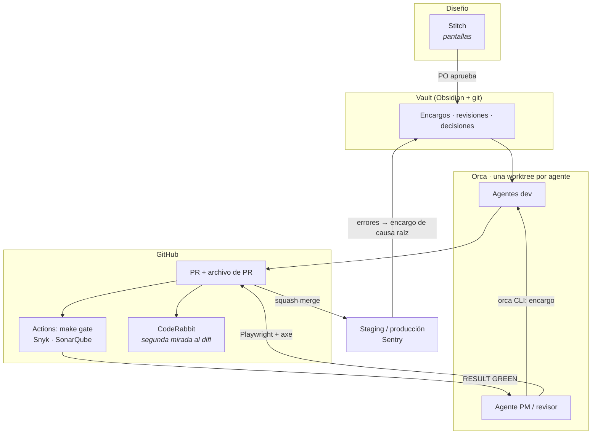

# Montar VERDE: herramientas recomendadas

VERDE no exige ninguna herramienta: los pilares se cumplen con `git`, Markdown y
la puerta. Esta guía es un punto de partida probado para montar el método
completo, con lo que cada herramienta aporta, en qué paso del ciclo entra y
cómo se conecta con la puerta. Si tu equipo ya usa otra, sirve igual mientras
cumpla la misma función.

> Los planes y precios cambian. Varias de estas herramientas tienen plan
> gratuito o gratuito para código abierto; revisa sus condiciones antes de
> depender de ellas en la CI (ver la lección de VERDE.md §12 sobre límites
> mensuales).

## El mapa



| Herramienta | Para qué | Pilar | Paso del ciclo | Cómo se conecta |
| --- | --- | --- | --- | --- |
| [Obsidian](https://obsidian.md) | Editar y navegar el vault | V | Todo el ciclo | El vault es un repo git; Obsidian sólo lo edita |
| [Orca](https://orca.dev) | Correr agentes en paralelo, una worktree cada uno | E, R | Implementación y revisión | El operador lanza agentes; el PM delega por la CLI |
| [Stitch](https://stitch.withgoogle.com) | Diseñar pantallas antes del código | E | Diseño | El PO aprueba; el encargo cita la pantalla |
| [GitHub Actions](https://github.com/features/actions) | CI espejo de la puerta | E (Evidencia) | Puerta y merge | `ci.yml` corre `make gate` |
| [Playwright](https://playwright.dev) + [axe](https://github.com/dequelabs/axe-core) | e2e y revisión en vivo | R, E | Puerta y revisión | Paso `e2e` y guía del revisor |
| [Snyk](https://snyk.io) | Vulnerabilidades en dependencias y código | E | Puerta | Paso opcional `?snyk` |
| [Dependabot](https://docs.github.com/code-security/dependabot) | Actualizar dependencias | E | Mantenimiento | PRs de mantenimiento con su encargo |
| [SonarQube Cloud](https://www.sonarsource.com/products/sonarqube/cloud/) o [SonarQube Server](https://www.sonarsource.com/products/sonarqube/) | Calidad, cobertura, duplicación | E | Puerta | Paso opcional `?sonar` o check de la CI |
| [CodeRabbit](https://www.coderabbit.ai) | Revisión automática del diff | R | Revisión | Comentarios en el PR que el revisor clasifica |
| [Sentry](https://sentry.io) | Errores y rendimiento en staging y producción | D, E | Después del merge | Cada error real abre un encargo de causa raíz |

## 1. Orquestar agentes con Orca

[Orca](https://orca.dev) es un entorno de escritorio para correr agentes de
línea de comandos (Claude Code, Codex, Gemini, Cursor, opencode y otros) en
paralelo, **cada uno en su propia worktree de git**, con terminales, diffs y un
navegador integrado. Es código abierto (MIT) y corre en macOS, Windows y Linux,
con una app móvil para seguir las sesiones.

Encaja con VERDE porque convierte en herramienta varias reglas del método:

- **Un agente por worktree** (principio 8): cada encargo es una worktree de
  Orca con su rama `feat/<KEY>-<n>-<slug>`.
- **El operador vigila sin intervenir**: ve todas las terminales en una
  pantalla y responde a los bloqueos sin abrir sesiones nuevas a mano.
- **El PM delega por la CLI**: un agente PM puede crear la worktree y lanzar al
  agente dev con el encargo, por ejemplo
  `orca worktree create --name ACME-12 --agent codex --prompt "Lee AGENTS.md y el encargo …"`.
  El dev avisa al PM cuando su PR está en verde, y el PM revisa.
- **Revisión en vivo**: el navegador integrado sirve para recorrer la app que
  levantó la worktree.

Las worktrees aíslan archivos, no puertos: dos agentes que levantan el mismo
stack chocan igual. Usa el paso `setup ports-free` de la puerta y turna los
entornos (VERDE.md §11).

## 2. Agentes recomendados por rol

Un rol es una responsabilidad; el agente es quien la ocupa hoy. Lo que pesa al
elegir es el tipo de trabajo, no la marca: los modelos cambian rápido, así que
revisa esta tabla en cada proyecto y registra la elección como una decisión.

| Rol | Qué necesita el agente | Recomendado | Notas |
| --- | --- | --- | --- |
| **PO** | — | Una persona | Puede apoyarse en un chat para redactar, pero decide y aprueba una persona. |
| **PM** | Escribir bien, contexto largo, criterio para decidir qué preguntar | Claude Code con un modelo de razonamiento alto (familia Opus), o Codex | Escribe el vault y delega por la CLI de Orca. Si también revisa, nunca revisa lo que escribió. |
| **Revisor** | Usar el navegador (Playwright), leer evidencia con desconfianza | Claude Code o Codex con un servidor MCP de Playwright | Calíbralo con fallas sembradas (guía del revisor §9). La aprobación final, una persona. |
| **Dev, encargos grandes** (épicas, migraciones, seguridad) | Seguir un encargo largo, correr la puerta, escribir evidencia | Codex o Claude Code | Una sesión por encargo y por ronda. |
| **Dev, encargos chicos y aislados** | Instrucciones exactas en pocos archivos | Cursor CLI, Gemini CLI o un modelo más pequeño | Sin migraciones; e2e en la CI si no tiene Docker. |
| **Dev local o con poco contexto** | Cambios mínimos y muy guiados | opencode con un modelo local (por ejemplo, Qwen) | Requiere comandos exactos y más supervisión del operador. |
| **Arquitecto** (opcional) | Diseño y ADR antes del código | [Kiro](https://kiro.dev) (diseño guiado por especificaciones) o el modelo de mayor razonamiento disponible | Si no hay, lo cubre el PM. |
| **Diseño de pantallas** | Generar e iterar UI | [Stitch](https://stitch.withgoogle.com) | Ver la sección 3. El PO aprueba. |

Reglas que no cambian con el agente:

- Todo agente tiene un operador humano (principio 11).
- Dos agentes del mismo operador no se aprueban entre sí.
- Los encargos de diseño o seguridad no van a modelos pequeños.

## 3. Diseñar con Stitch

[Stitch](https://stitch.withgoogle.com), de Google Labs, genera pantallas a
partir de texto o de una imagen, permite iterarlas en un lienzo y exportarlas a
Figma o a código. También tiene un servidor MCP, así que un agente puede leer
la pantalla aprobada.

Cómo entra en el ciclo (VERDE.md §4, paso 2):

1. El PM escribe el prompt de diseño desde el backlog: issue, criterios y
   estados que la pantalla debe mostrar (vacío, error, sin permisos).
2. Se generan e iteran las pantallas en Stitch.
3. **El PO aprueba** las pantallas y la decisión se registra (`D-xxx`).
4. Las capturas van a `99-Adjuntos/` del vault, y el encargo cita la pantalla
   aprobada (captura e identificador de Stitch).
5. El dev implementa con los componentes del proyecto; el código exportado
   sirve de referencia, no se pega tal cual.
6. El revisor compara la app en vivo con la pantalla aprobada. Una diferencia
   sin decisión que la respalde es un hallazgo.

Diseño antes que código: con las pantallas aprobadas antes de implementar, los
cambios llegan como pulido y no como rediseño (VERDE.md §12).

## 4. Complementos de calidad y seguridad

Todos se conectan a la misma regla: **la puerta decide el merge**. Lo que corre
en la CI debe poder correr también en la puerta local, aunque sea como paso
opcional.

### GitHub Actions

La CI remota es un espejo de la puerta, no otra fuente de verdad. La plantilla
de repo trae dos workflows:

- `ci.yml` corre `make gate` y sube el log y las capturas como artefactos;
- `pr-title.yml` exige el formato `<KEY>-<n>: …`.

Protege `main` con el check `gate` requerido, PR obligatorio y squash only. Si
la CI no está disponible (facturación, límites), manda la puerta local.

### Snyk y Dependabot

[Snyk](https://snyk.io) encuentra vulnerabilidades en dependencias, código e
imágenes. Va como paso **opcional** porque su plan gratuito tiene límites de
pruebas:

```text
step ?snyk: snyk test --severity-threshold=high
```

Una política que funciona: Snyk bloquea por dependencias de producción, y las
de desarrollo se atienden con [Dependabot](https://docs.github.com/code-security/dependabot),
que abre PRs de actualización. Cada PR de Dependabot pasa por la puerta como
cualquier otro.

### SonarQube Cloud o SonarQube Server

SonarQube mide calidad, cobertura, duplicación y problemas de seguridad, y
define un *quality gate*. Hay dos variantes: **SonarQube Cloud** (antes
SonarCloud), como servicio, y **SonarQube Server**, que se instala (su edición
Community se levanta con Docker para la puerta local).

```text
step ?sonar: sonar-scanner -Dsonar.qualitygate.wait=true
```

Con `sonar.qualitygate.wait=true` el paso falla si el quality gate falla, así
que entra en la puerta como cualquier otro check. El umbral de cobertura de
VERDE (80 % por defecto) y el de Sonar deben ser el mismo.

### CodeRabbit

[CodeRabbit](https://www.coderabbit.ai) comenta cada PR con un resumen y
observaciones sobre el diff. Es una **segunda mirada**, no el revisor:

- no abre la aplicación ni verifica la evidencia de los criterios;
- sus comentarios los clasifica el revisor: los que valen se convierten en
  hallazgos `R` o `N` de la revisión, y los demás se descartan con una línea;
- configúralo (`.coderabbit.yaml`) para que lea `AGENTS.md` y no pida cambios
  fuera del alcance del encargo.

### Sentry

[Sentry](https://sentry.io) captura errores y rendimiento en staging y en
producción. Cierra el ciclo de VERDE:

- marca cada despliegue con el commit (`release` = sha del squash), para saber
  qué PR introdujo un error;
- sube los *source maps* en la CI para ver el código real;
- un error nuevo no se arregla en caliente: abre un encargo de **causa raíz**
  con el enlace al evento de Sentry como evidencia del síntoma (principio 7).

## 5. Por dónde empezar

| Nivel | Herramientas | Cuándo |
| --- | --- | --- |
| **Mínimo** | Obsidian, GitHub Actions, Playwright + axe | Desde el Día 0. Es lo que la plantilla ya trae. |
| **Recomendado** | + Orca, Stitch, Snyk, Dependabot, SonarQube, CodeRabbit | Cuando hay más de un agente en paralelo o pantallas nuevas. |
| **Producción** | + Sentry | Antes del primer despliegue a usuarios reales. |

Registra cada herramienta que adoptes como una decisión de arranque (`D-00n`),
con su plan y quién la administra. Así, cuando un límite o un precio cambie, se
sabe qué depende de ella.
