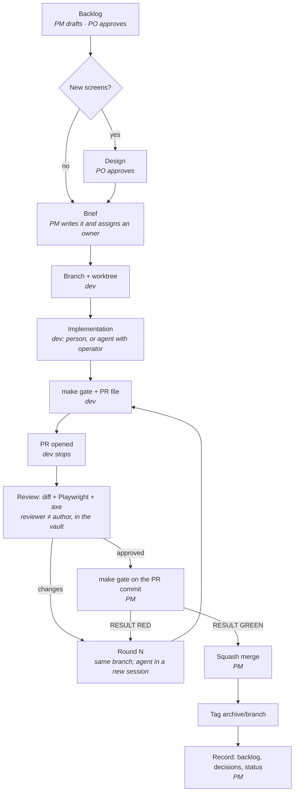

# VERDE · Vault-Driven Development

**Version 1.3.0 · 2026-11-13 · © 2026 Javier Batres · CC BY 4.0**

> English translation of [`VERDE.md`](../../VERDE.md). The Spanish text is the
> reference: if they ever differ, the Spanish one rules. File and folder names
> from the templates (`03-Encargos/`, `Registro-de-decisiones.md`…) keep their
> Spanish names, because that is how they ship.

VERDE is a framework for building applications with AI agents in a team with
fixed roles. *Verde* means green in Spanish, and the name sums up the rule:
**nothing moves forward unless it is green**. Its letters are its five pillars:

| | Pillar | In Spanish | In one sentence |
| --- | --- | --- | --- |
| **V** | Vault | Vault | The project's memory lives outside the code and outside the chat. |
| **E** | Engagement brief | Encargo | All work comes in writing, with scope and expected evidence. |
| **R** | Review | Revisión | The reviewer sees the application running, not just the diff. |
| **D** | Decision | Decisión | Every decision is numbered, dated and has a status. |
| **E** | Evidence | Evidencia | Nothing is merged without the checks gate at `RESULT GREEN`. |

The method is also called **VDD (Vault-Driven Development)**, in the style of
TDD or BDD: in TDD the test comes first; in VDD, the vault. What is not in the
vault was not decided, and what has no evidence is not done.

---

## 1. Principles

1. **The vault rules.** If it is not in the vault, it was not decided. The chat
   forgets; the vault does not.
2. **All work comes in as a brief.** Nobody, person or agent, gets "fix this"
   in the chat: they get a file with a goal, scope and criteria.
3. **Whoever delivers writes the evidence.** The reviewer verifies what is
   written instead of rediscovering it.
4. **The reviewer sees the application.** A UI change is not approved by
   reading code.
5. **The gate decides the merge.** Not confidence, not hurry: `RESULT GREEN`.
6. **Every decision is numbered.** `D-xxx`, with date, origin and status. It is
   never deleted: it is superseded.
7. **Causes, not symptoms.** No retries are added and no design is changed to
   silence a check.
8. **One session per brief, one agent per worktree.** State lives in the branch
   and in the PR file, not in the conversation.
9. **Roles are not tools.** A role can be held by a person or by an agent; the
   method does not change.
10. **Whoever writes does not approve.** The reviewer of a delivery is never
    its author.
11. **Every agent has an accountable human.** An agent works under an operator
    who launches it, watches it and answers for its delivery.

## 2. The five pillars

### V · Vault

**What it is:** a repository of Markdown notes (designed for Obsidian, any
editor works) with the product, the backlog, the briefs, the reviews, the
meetings, the decisions and the project status.

**Where it lives:** in **its own private git repo** (`<project>-vault`), cloned
next to the code repo. It does not go inside the code repo: it has a different
pace, different authors and a different level of confidentiality.

**Who writes it:** the PO, the PM and the reviewers, with commit and push
straight to `main`. Devs **read** it: agents through the path in their
`AGENTS.md`; people with their own clone. If a dev needs to change something in
the vault (a decision, a criterion), they propose it in their PR file and
whoever writes the vault records it.

**Minimum rule:** every brief, review, meeting and decision is a vault note,
created from its template.

**Anti-pattern:** "we talked about it in the chat". If an agent needs something
that only lives in a conversation, the next session will not know it.

### E · Engagement brief

**What it is:** the document the dev receives, person or agent. Together with
`AGENTS.md`, it is the **only** thing they need. Every brief has **one owner**:
a human dev or an agent with its operator.

**Where it lives:** `03-Encargos/` in the vault.

**Who writes it:** the PM; the PO approves it when the brief changes scope or
product.

**Minimum rule:** a brief has:

- origin (who asked for it and which decision backs it);
- branch and worktree;
- **verifiable** criteria, each with its expected evidence;
- closed scope (what is in, what is out, whether there are migrations or new
  dependencies);
- environment (whether it can start Docker);
- explicit out-of-scope;
- what to do when blocked: write the question down and stop.

**Anti-pattern:** the brief that states the symptom without asking for the
cause. The agent will fix the symptom (see section 12).

### R · Review

**What it is:** the verification of a PR, written in the vault.

**Where it lives:** `06-Revisiones/`, one note per PR and round.

**Who writes it:** a reviewer who **is not the author**. In a small team it is
the PM; in a large one, the PM assigns reviewers. An agent can review, but the
final approval is signed by a person with the reviewer or PM role.

**Minimum rule:**

- every criterion is checked against the evidence;
- if there is UI, the application is opened with **Playwright**, the flow is
  walked through, screenshots are taken and **axe** is run;
- at least one test from the evidence of each criterion is reproduced, instead
  of just reading it;
- every finding has an ID, a location and a severity. **Blocking** and
  **major** (`R1`, `R2`…) are fixed in this PR; **minor** and **note** (`N1`…)
  do not block and get a destination: this round, a maintenance brief, watch,
  or no action;
- the result goes through `cambios-requeridos` (changes requested) →
  `aprobado-por-revisor` (approved by reviewer) → `aprobado` (approved, PO) →
  `integrado` (merged, PM).

The full procedure, with what to look at live and how to launch and calibrate a
reviewer agent, is in [the reviewer guide](templates/repo/docs/guides/review.md).

**Anti-pattern:** approving by reading the diff. UI problems (contrast, a
misplaced button, a broken empty state) do not show in the code.

**Counterweight:** reviewers make mistakes too. The dev can push back on the
review with evidence, and that is part of the process.

### D · Decision

**What it is:** the numbered record of what was decided.

**Where it lives:** `04-Decisiones/Registro-de-decisiones.md` in the vault;
technical ones also as an ADR in the repo's `docs/adr/`, with an index in
`docs/decisions.md`.

**Who writes it:** the PM, the same day, with its origin (meeting, brief,
review) and the PO's approval.

**Minimum rule:** `D-xxx`, consecutive and never reused, with a status:

| Status | Means |
| --- | --- |
| ✅ vigente (in force) | Applies today. |
| 🔁 reemplazada (superseded) | Another decision replaces it and cites it. |
| ⏸️ en pausa (paused) | Still valid, but not applied until further notice. |
| ⏳ pendiente (pending) | Identified, not decided yet. |

Code, briefs and PRs cite decisions by ID.

**Anti-pattern:** deleting or rewriting an old decision. The why is lost.

### E · Evidence

**What it is:** the **gate**, a single command (`make gate`) that runs every
check and answers green or red, plus the PR file with the evidence for each
criterion.

**Where it lives:** `tools/ci/local-gate.sh` and `gate.steps` in the repo;
`docs/prs/<KEY>-<n>-<slug>.md` for each PR.

**Who produces it:** the dev runs it before opening the PR; whoever merges runs
it again on the exact commit before the merge.

**Minimum rule:** format, lint, tests, build, coverage (≥ the project's
threshold, 80 % by default), e2e and security. The output is always the same:

```text
head 3f2a9c1 · 2026-11-11 10:42:07
PASS format
PASS lint
PASS test
PASS build
PASS coverage
PASS infra
PASS e2e
PASS infra-down
SKIP snyk
RESULT GREEN · log tmp/gate.log
```

**Anti-pattern:** "it passes on my machine". If there is no gate output pasted
in the PR, there is no evidence.

## 3. Roles

A role is a responsibility, not a person or a tool. One person can hold several
roles (in a small team, the PM is often also a reviewer), with a single
exception: **nobody reviews their own delivery**.

| Role | Responsibility | Person or agent | Does not |
| --- | --- | --- | --- |
| **PO** | Decides what gets built and why. Approves backlog, designs, briefs that change scope, and deliveries. Decides open questions. | Person | — |
| **PM** | Writes backlog, briefs, decisions and status in the vault. Assigns briefs and reviewers. Merges (squash merge) when the review is approved and the gate is green. | Person or agent | Merge without approval or with the gate red. |
| **Reviewer** | Verifies each delivery against its criteria, reviews it live with Playwright and writes the review. | Person or agent (final approval: a person) | Review what they wrote. |
| **Dev** | Implements a brief on its branch, writes the evidence and opens the PR. | Person or agent | Merge, push to `main`, `--force`, `--no-verify`, touch anything outside scope. |
| **Operator** | Launches dev agents with their brief, watches them, unblocks them and answers for what they deliver. | Person | Leave an agent unsupervised or with permissions beyond its worktree. |
| **Architect** (optional) | Designs and ADRs that block the work depending on them. If there is none, the PM covers it. | Person or agent | — |

### Developers

In VERDE, a **human developer** usually works as an **operator**: they receive
one or more briefs, launch them with agents, watch them and answer for what
they deliver. They can also **write the code themselves**; then they are the
dev of their brief and follow exactly the same cycle:

- they work from a vault brief, on their own branch;
- they run `make gate` and write the PR file with the evidence;
- their PR is reviewed by another person or an agent, with final approval by a
  person.

Whether a person or an agent writes the code changes nothing in the process:
the evidence and the review are the same. What changes is who answers for it:
the operator for their agents, the human dev for their own code.

The operator:

- picks the agent and model that fit the brief (small, exact briefs allow small
  models; design or security ones do not);
- prepares the worktree and the environment, and launches the agent with the
  brief;
- watches without stepping into the content: if the agent is blocked by
  something the brief does not decide, the question goes to the PM, nobody
  improvises;
- checks that the delivery is complete (evidence, gate green) before asking for
  review. This is not the review: it is making sure the PR is ready.

## 4. The cycle



1. **Backlog.** The PM drafts epics, issues and verifiable criteria. The PO
   approves.
2. **Design.** If there are new screens, they are designed and the PO approves
   them before implementation.
3. **Brief.** The PM writes it from the template and assigns it to an owner: a
   human dev or an operator with their agent.
4. **Branch and worktree.** The dev creates `feat/<KEY>-<n>-<slug>` from `main`
   in a worktree of its own.
5. **Implementation.** Commits `<KEY>-<n>: <imperative>`.
6. **Evidence.** The dev runs `make gate`, writes the PR file and opens the PR.
   Then stops.
7. **Review.** A reviewer who is not the author verifies the criteria, reviews
   live and writes the review.
8. **Rounds.** If changes are needed, the dev makes them on the same branch (an
   agent, in a **new session**) and adds "Round N" to the PR file, answering
   each finding by its ID. The reviewer verifies each ID in a "Ronda N"
   (round N) section.
9. **Merge.** The PM runs the gate on the PR commit, pastes the output in the PR
   and squash merges with `--match-head-commit`. The branch is archived as the
   tag `archive/<branch>` and deleted.
10. **Record.** The PM updates the backlog, the decisions and the day's status.

## 5. Teams with several members

VERDE works the same with three members as with fifteen. As the team grows,
these rules are added:

- **One brief, one owner.** Each brief has a single dev or a single operator.
  The backlog shows who has it; nobody takes an assigned brief.
- **Work-in-progress limit.** Each operator watches only the agents they can
  really follow at once (two or three is typical). Each human dev has one brief
  in progress, plus those waiting for review.
- **Cross review.** The PM assigns reviewers. Author and reviewer are always
  different, and two agents of the same operator never approve each other.
- **One vault, one record.** The whole product shares one vault and a single
  decision numbering, even with several teams. If there are several PMs, each
  writes the briefs of their area and all record in the same
  `Registro-de-decisiones.md`.
- **Non-overlapping areas.** Briefs running in parallel do not touch the same
  modules. If it cannot be avoided, they are sequenced: one is merged and the
  other starts from the updated `main`.
- **Separate environments.** Each dev or operator has their local environment;
  agents sharing a machine take turns with ports or use isolated environments.
- **A single merge queue.** Only the PM (or the integrators they appoint)
  merges, one at a time, always with the gate run on the exact commit.
- **Daily status.** The day's status in the vault gathers what landed, what is
  in progress, what is blocked and who has each thing.

## 6. What it looks like in practice

**Minimal team: a PO, a PM and agents.** The PO sets the day's priority. The
PM, who also reviews, writes two briefs. The PO acts as operator: launches one
agent per brief, each in its worktree, and watches their terminals. When an
agent opens its PR, the PM reviews it live, asks for a round or approves it,
runs the gate and merges. At the end of the day the PM updates backlog,
decisions and status.

**Team of six: a PO, a PM and four devs.**

1. In the morning the PO and the PM confirm priorities. The PM already has six
   briefs ready in the vault, from different areas, and assigns them.
2. Three devs operate agents: each launches two agents with their briefs and
   watches them. The fourth dev hand-writes a delicate brief (a data
   migration) because they prefer to do it themselves.
3. Mid-morning an agent gets blocked: the brief does not say whether a field is
   required. Its operator does not decide: they ask the PM, who settles it with
   the PO, records `D-087` and updates the brief. The agent resumes in a new
   session.
4. Every PR that opens is reviewed by someone who did not write it. The PR of
   the dev who coded by hand is reviewed by another dev, with an agent helping
   with the live review. The agents' PRs are reviewed by the PM or by a dev from
   another area.
5. The PM merges in order: gate on the exact commit, squash and archive tag. If
   two PRs touch the same thing, they merge one and ask the other to update its
   branch.
6. At closing time, the day's status shows what was merged, what is in review
   and what is blocked, with its owner.

## 7. Conventions

| What | Format | Example |
| --- | --- | --- |
| Issue key | `<KEY>-<n>` | `ACME-42` |
| Work branch | `feat/<KEY>-<n>-<slug>` | `feat/ACME-42-login` |
| Maintenance branch | `maint/<KEY>-<n>-<slug>` | `maint/ACME-57-flaky-e2e` |
| Commit | `<KEY>-<n>: <imperative>` (< 72 characters, no period) | `ACME-42: Add email login form` |
| PR title | same as a commit | `ACME-42: Email login` |
| PR file | `docs/prs/<KEY>-<n>-<slug>.md` | `docs/prs/ACME-42-login.md` |
| Decision | `D-xxx` | `D-017` |
| ADR | `docs/adr/NNNN-<topic>.md` | `docs/adr/0003-auth.md` |
| Archived branch | tag `archive/<branch>` | `archive/feat/ACME-42-login` |
| Brief | `03-Encargos/<KEY>-<n>-<owner>-<topic>.md` | `ACME-42-ana-login.md` |
| Review | `06-Revisiones/<KEY>-<n>-revision.md` | `ACME-42-revision.md` |
| Severity | bloqueante · mayor · menor · nota (blocking · major · minor · note) | — |
| Finding | `R<n>` (blocks) · `N<n>` (does not block) | `R1`, `N2` |

A group of issues delivered in a single PR can have its own key. Call it what
you like (story, delivery, *carrier*); the method does not require it.

Merges are **squash only**: one delivery, one commit on `main`.

## 8. The gate

The gate is the pillar that enforces the others. It is implemented with two
files from the repo template:

- `tools/ci/local-gate.sh`, which knows nothing about your stack;
- `gate.steps`, where you declare the steps:

```text
# <kind> <name>: <command>
step format: npx prettier --check .
step lint: npm run lint
step test: npm test
setup infra: docker compose up -d --wait
step e2e: npx playwright test
teardown infra-down: docker compose down
step ?snyk: snyk test --severity-threshold=high
```

- **`setup`** and **`step`** run in file order: put each `setup` before the
  steps that need it. If a `setup` fails, the following steps are skipped and
  the result is red.
- A **`step`** runs even if a previous one failed, so you see every problem in
  one run.
- **`teardown`** always runs, at the end.
- **`?name`** marks an optional step: if the tool is not installed, it gives
  `SKIP`. Use it for services with limits or licenses (cloud security
  scanners), never to silence a mandatory step. The tool is the first token of
  the command; `cd <folder> &&` prefixes are ignored.
- **Coverage:** the step must **fail** below the threshold, not just print the
  percentage. The examples for each stack already do.
- **Preconditions:** a `setup` can check, before starting anything, that the
  environment is free (for example, `ports-free` checks that the ports are not
  taken by another instance).

The exit code is 0 (green), 1 (red) or 2 (malformed `gate.steps`). The full log
stays in `tmp/gate.log`.

**Any stack.** The example is Node, but the script only runs the commands you
declare. The template ships commented blocks for Python, Go, Java, .NET and
monorepos; keep the one that applies.

**Operating systems.** The gate needs `bash` and `make`. macOS and Linux
already have them. On Windows, use WSL (with `make` installed) or Git Bash; Git
Bash has no `make`, so run `bash tools/ci/local-gate.sh` there. The commands of
each step must exist in that same environment.

**Remote CI.** The `ci.yml` workflow runs the same gate. When remote CI is not
available (billing, limits of an external service), **the local gate rules**:
the PM runs it and pastes the output in the PR. Remote CI is a mirror, not a
second source of truth.

**Flaky tests.** If a step fails unrelated to the diff and passes when run on
its own, **one** re-run of that step is allowed for the merge, it is noted in
the PR and a root-cause brief is opened. Retries are never added and timeouts
are never raised to hide it.

## 9. Day 0 of a new project

- [ ] Pick the issue key (`<KEY>`) and run
      `./init.sh <project> <KEY> <folder>`: it creates `<project>/` and
      `<project>-vault/` side by side, fills in the project, the key and the
      dates, and makes the first commit in both.
- [ ] Fill in the remaining placeholders (names, URLs, commands) in
      `AGENTS.md`, `README.md`, `docs/vault.md`, `docs/guides/` and the vault's
      `00-Inicio.md`. The `<n>` and `<slug>` in guides and templates are
      conventions and stay. Push both repos as private.
- [ ] Record **D-001 · We adopt VERDE / VDD v1.3.0** and the kickoff decisions
      (stack, scope, who holds each role).
- [ ] Choose the tools (agents by role, orchestration, design, CI, security,
      quality, observability) with [`guias/herramientas.md`](guias/herramientas.md)
      and record them as decisions.
- [ ] Adjust `gate.steps` to the stack and run `make gate` until
      `RESULT GREEN` with the project skeleton.
- [ ] Assign the roles: PO, PM, reviewers, devs and operators. Write them in the
      vault's `00-Inicio.md` and in `AGENTS.md`.
- [ ] Complete `AGENTS.md`: project, vault path, roles, commands.
- [ ] On GitHub (or equivalent):
  - define the repo variable `ISSUE_KEY`;
  - protect `main` with required PRs, squash only, the `gate` check required
    and no direct push;
  - load the CI secrets.
- [ ] Give every team member access to both repos.
- [ ] Write the backlog of the first delivery and the first brief. The worked
      example [`examples/acme/`](examples/acme/README.md) shows a complete
      issue, from its brief to its merge.
- [ ] If an agent is going to review, calibrate it first (section 11).
- [ ] Launch the first agent in its worktree and review the first PR through
      the full cycle, however small: that tests the process before the product.

## 10. Context hygiene for agents

Every step of an agent rereads the whole conversation, so almost all token
usage is rereading, and a few long sessions account for most of it. Therefore:

- **A new session per brief and per round.** State lives in the branch and in
  the PR file.
- **Filtered output** (`tail`, `grep`). Never paste full logs; the gate already
  keeps the log.
- **Wait for CI with a blocking command** (`gh pr checks <n> --watch`), never
  with a polling loop.
- **Small briefs.** A closed brief lands in one round; a large epic is split
  into parts that can be reviewed separately.
- **Small or local models** are fine for changes to a few files with exact
  instructions, not for design.

## 11. Launching an agent

```sh
git worktree add ../<project>-<KEY>-<n> -b feat/<KEY>-<n>-<slug> origin/main
cd ../<project>-<KEY>-<n>
<agent> "Read AGENTS.md and the brief ../<project>-vault/03-Encargos/<file>.md. Complete the whole brief."
```

- One agent per worktree. Broad permissions (no approval per command) only
  inside its worktree and with a closed brief.
- A new worktree does not include ignored files (`.env`): copy them or let the
  agent create them from `.env.example`.
- If two agents need the same environment with fixed ports, they take turns.
  Two stacks at once fail in ways that look like bugs.
- The operator watches the agent's terminal; someone else reviews the result.
  Separating those two tasks keeps the reviewer from becoming a co-author.

**Launching a reviewer.** The same, but with a worktree on the exact PR commit
(`git worktree add ../<project>-review-<KEY>-<n> <sha>`), an operator other
than the one who launched the author, and the prompt in the reviewer guide §8.
The agent writes its review note and leaves it as `cambios-requeridos` or
`aprobado-por-revisor`; a person signs it.

**Calibrating the reviewer.** Before trusting a reviewer agent, and every time
the model or the guide changes, it gets a branch with four seeded faults (one
visual, one accessibility, a criterion with misleading evidence and one logic
fault without UI). Whatever it misses is added to the guide (§9 of the reviewer
guide).

## 12. Lessons

What ignoring these rules costs:

- **The agent fixes the symptom if the brief does not ask for the cause.**
  Faced with a contrast check failing on a primary button, the agent may switch
  it to secondary and the check passes, even if the cause is something else
  (for example, a CSS transition that the test measures halfway through).
- **Written evidence saves half the review.** With commands and outputs in the
  PR file, reviewing is verifying.
- **Design before code.** With screens approved before implementation, changes
  arrive as polish, not as redesign.
- **Flaky tests are almost always about order or time:** rows created in the
  same transaction with the same timestamp, the day rolling over in the middle
  of an e2e run, a short timeout under load. They are fixed in the test or in
  the code.
- **External CI dependencies stall work without any error:** CI billing or a
  scanner's monthly limit. The local gate keeps that from stopping the work.
- **Two environments at once fail as if they were bugs.** A port taken by
  another instance makes the e2e fail. The gate must check its preconditions
  before starting, with a `setup` (see section 8).
- **Fewer agents, more stable.** A single dev and a PM who reviews give a more
  predictable flow than several agents in similar roles.
- **Merge with squash only.** A merge commit muddies the history of `main`
  forever.

## 13. Glossary

| English | Spanish | What it is |
| --- | --- | --- |
| Vault | Vault | Notes repo with the project's memory. |
| Engagement brief | Encargo | Work document for a dev, person or agent. |
| Review | Revisión | Written verification of a PR, with a live review. |
| Decision | Decisión | Numbered `D-xxx` entry in the record. |
| Evidence | Evidencia | Gate output and proof for each criterion. |
| Gate | Puerta | `make gate`: every check, green or red. |
| PR file | Archivo de PR | `docs/prs/…`: evidence and rounds of a PR. |
| Round | Ronda | Iteration of changes after a review. |
| Finding | Hallazgo | Problem noted in a review: `R<n>` blocks, `N<n>` does not. |
| Calibration | Calibración | Testing a reviewer with deliberately seeded faults. |
| Acceptance criterion (AC) | Criterio de aceptación | Verifiable condition of an issue. |
| Product owner (PO) | Dueño del producto | Person who prioritizes and approves. |
| PM | PM | Role that writes the vault, assigns and merges. |
| Reviewer | Revisor | Role that verifies someone else's delivery. |
| Dev | Dev | Whoever implements a brief, person or agent. |
| Operator | Operador | Person who launches, watches and answers for dev agents. |

## 14. Version and license

This document is **VERDE v1.3.0**. VERDE follows
[Semantic Versioning](https://semver.org/) and records its changes in the
[`CHANGELOG`](CHANGELOG.md):

| Change | When | What a project does |
| --- | --- | --- |
| **MAJOR** (`2.0.0`) | A pillar, a principle or a mandatory rule changes, or something projects depend on breaks: the `gate.steps` format, the gate's output and exit codes, the conventions in §7, the `init.sh` interface or the structure of the templates | Reads the migration notes and records a decision before adopting it |
| **MINOR** (`1.4.0`) | Adds guides, templates, examples or compatible capabilities | Adopts whatever helps, no migration |
| **PATCH** (`1.3.1`) | Fixes errors, text or examples without changing rules or adding content | Can update right away |

Each project records in its D-001 the version it adopted, and records a new
decision when it adopts another one.

Text under [CC BY 4.0](../../LICENSE); scripts and code templates under
[MIT](../../LICENSE-CODE). © 2026 Javier Batres.
