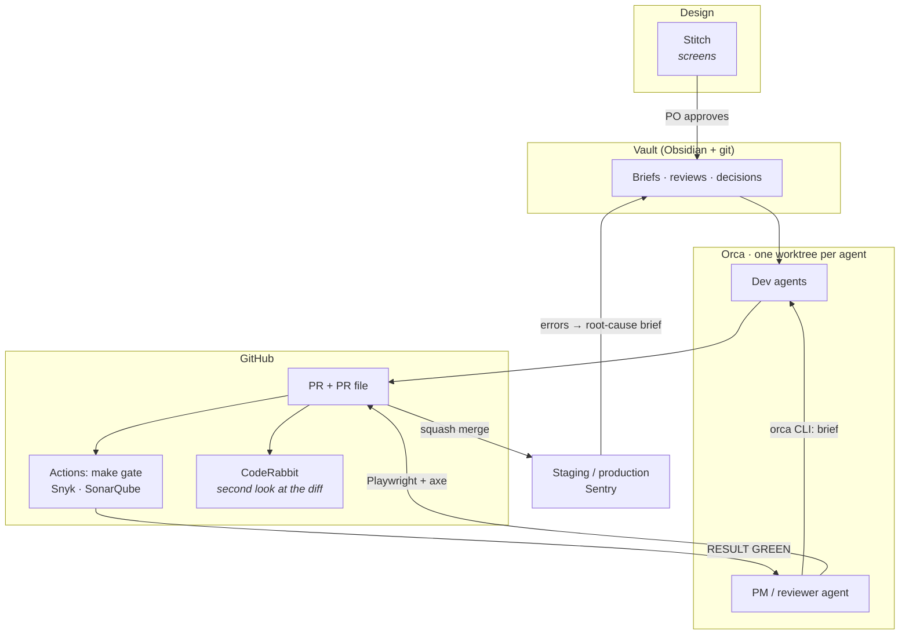

# Setting up VERDE: recommended tools

> English translation of [`guias/herramientas.md`](../../../guias/herramientas.md).
> The Spanish text is the reference.

VERDE does not require any tool: the pillars are met with `git`, Markdown and
the gate. This guide is a tested starting point for setting up the full
method: what each tool adds, which step of the cycle it belongs to and how it
connects to the gate. If your team already uses something else, it works just
as well as long as it does the same job.

> Plans and prices change. Several of these tools have a free plan or are free
> for open source; check their terms before depending on them in CI (see the
> lesson in VERDE.md §12 about monthly limits).

## The map



| Tool | What for | Pillar | Cycle step | How it connects |
| --- | --- | --- | --- | --- |
| [Obsidian](https://obsidian.md) | Edit and browse the vault | V | Whole cycle | The vault is a git repo; Obsidian only edits it |
| [Orca](https://orca.dev) | Run agents in parallel, one worktree each | E, R | Implementation and review | The operator launches agents; the PM delegates through the CLI |
| [Stitch](https://stitch.withgoogle.com) | Design screens before the code | E | Design | The PO approves; the brief cites the screen |
| [GitHub Actions](https://github.com/features/actions) | CI that mirrors the gate | E (Evidence) | Gate and merge | `ci.yml` runs `make gate` |
| [Playwright](https://playwright.dev) + [axe](https://github.com/dequelabs/axe-core) | e2e and live review | R, E | Gate and review | `e2e` step and reviewer guide |
| [Snyk](https://snyk.io) | Vulnerabilities in dependencies and code | E | Gate | Optional `?snyk` step |
| [Dependabot](https://docs.github.com/code-security/dependabot) | Keep dependencies updated | E | Maintenance | Maintenance PRs with their brief |
| [SonarQube Cloud](https://www.sonarsource.com/products/sonarqube/cloud/) or [SonarQube Server](https://www.sonarsource.com/products/sonarqube/) | Quality, coverage, duplication | E | Gate | Optional `?sonar` step or a CI check |
| [CodeRabbit](https://www.coderabbit.ai) | Automated diff review | R | Review | PR comments the reviewer triages |
| [Sentry](https://sentry.io) | Errors and performance in staging and production | D, E | After the merge | Every real error opens a root-cause brief |

## 1. Orchestrating agents with Orca

[Orca](https://orca.dev) is a desktop environment for running command-line
agents (Claude Code, Codex, Gemini, Cursor, opencode and others) in parallel,
**each in its own git worktree**, with terminals, diffs and a built-in browser.
It is open source (MIT) and runs on macOS, Windows and Linux, with a mobile app
to follow the sessions.

It fits VERDE because it turns several of the method's rules into a tool:

- **One agent per worktree** (principle 8): each brief is an Orca worktree with
  its `feat/<KEY>-<n>-<slug>` branch.
- **The operator watches without stepping in**: they see every terminal on one
  screen and answer blockers without opening sessions by hand.
- **The PM delegates through the CLI**: a PM agent can create the worktree and
  launch the dev agent with the brief, for example
  `orca worktree create --name ACME-12 --agent codex --prompt "Read AGENTS.md and the brief …"`.
  The dev tells the PM when its PR is green, and the PM reviews.
- **Live review**: the built-in browser is handy for walking through the app
  the worktree started.

Worktrees isolate files, not ports: two agents starting the same stack still
collide. Use the gate's `setup ports-free` step and take turns with
environments (VERDE.md §11).

## 2. Recommended agents by role

A role is a responsibility; the agent is whoever holds it today. What matters
when choosing is the kind of work, not the brand: models change fast, so review
this table in every project and record the choice as a decision.

| Role | What the agent needs | Recommended | Notes |
| --- | --- | --- | --- |
| **PO** | — | A person | Can lean on a chat to draft, but a person decides and approves. |
| **PM** | Good writing, long context, judgment about what to ask | Claude Code with a high-reasoning model (Opus family), or Codex | Writes the vault and delegates through the Orca CLI. If it also reviews, it never reviews what it wrote. |
| **Reviewer** | Using the browser (Playwright), reading evidence with distrust | Claude Code or Codex with a Playwright MCP server | Calibrate it with seeded faults (reviewer guide §9). Final approval: a person. |
| **Dev, large briefs** (epics, migrations, security) | Following a long brief, running the gate, writing evidence | Codex or Claude Code | One session per brief and per round. |
| **Dev, small isolated briefs** | Exact instructions across few files | Cursor CLI, Gemini CLI or a smaller model | No migrations; e2e in CI if it has no Docker. |
| **Local dev or small context** | Minimal, tightly guided changes | opencode with a local model (for example, Qwen) | Needs exact commands and more supervision from the operator. |
| **Architect** (optional) | Design and ADRs before the code | [Kiro](https://kiro.dev) (spec-driven design) or the highest-reasoning model available | If there is none, the PM covers it. |
| **Screen design** | Generate and iterate UI | [Stitch](https://stitch.withgoogle.com) | See section 3. The PO approves. |

Rules that do not change with the agent:

- Every agent has a human operator (principle 11).
- Two agents of the same operator never approve each other.
- Design or security briefs do not go to small models.

## 3. Designing with Stitch

[Stitch](https://stitch.withgoogle.com), from Google Labs, generates screens
from text or an image, lets you iterate them on a canvas and export them to
Figma or to code. It also has an MCP server, so an agent can read the approved
screen.

How it fits the cycle (VERDE.md §4, step 2):

1. The PM writes the design prompt from the backlog: issue, criteria and the
   states the screen must show (empty, error, no permissions).
2. The screens are generated and iterated in Stitch.
3. **The PO approves** the screens and the decision is recorded (`D-xxx`).
4. Screenshots go to the vault's `99-Adjuntos/`, and the brief cites the
   approved screen (screenshot and Stitch identifier).
5. The dev implements with the project's components; exported code is a
   reference, not something to paste as is.
6. The reviewer compares the live app with the approved screen. A difference
   with no decision behind it is a finding.

Design before code: with screens approved before implementation, changes arrive
as polish and not as redesign (VERDE.md §12).

## 4. Quality and security add-ons

They all connect to the same rule: **the gate decides the merge**. Whatever runs
in CI must also be able to run in the local gate, even as an optional step.

### GitHub Actions

Remote CI mirrors the gate; it is not a second source of truth. The repo
template ships two workflows:

- `ci.yml` runs `make gate` and uploads the log and the screenshots as
  artifacts;
- `pr-title.yml` enforces the `<KEY>-<n>: …` format.

Protect `main` with the `gate` check required, PRs required and squash only. If
CI is not available (billing, limits), the local gate rules, but the `gate`
check is not published and GitHub blocks the merge. For that case:

1. Only whoever administers the repo (the PO, or whoever they appoint in a
   `D-xxx` decision) relaxes the protection, and only for that PR.
2. The PM runs `make gate` on the PR's exact commit and pastes the output in a
   PR comment, with the sha and the reason CI is missing. It is local
   evidence, not a CI check.
3. The PR is merged with `--match-head-commit <sha>` and, right after, whoever
   relaxed the protection restores it and notes it in the same PR.

### Snyk and Dependabot

[Snyk](https://snyk.io) finds vulnerabilities in dependencies, code and images.
It is an **optional** step (the `?` prefix) because its free plan has test
limits: if `snyk` is not installed, the gate marks it `SKIP` and the result does
not change. If it is installed and finds vulnerabilities above the threshold,
the step fails like any other:

```text
step ?snyk: snyk test --severity-threshold=high
```

A policy that works: Snyk blocks on production dependencies, and development
ones are handled with
[Dependabot](https://docs.github.com/code-security/dependabot), which opens
update PRs. Every Dependabot PR goes through the gate like any other.

### SonarQube Cloud or SonarQube Server

SonarQube measures quality, coverage, duplication and security issues, and
defines a *quality gate*. There are two flavors: **SonarQube Cloud** (formerly
SonarCloud), as a service, and **SonarQube Server**, which you install (its
Community edition runs in Docker for the local gate).

```text
step ?sonar: sonar-scanner -Dsonar.qualitygate.wait=true
```

With `sonar.qualitygate.wait=true` the step fails if the quality gate fails, so
it enters the gate like any other check. VERDE's coverage threshold (80 % by
default) and Sonar's must be the same.

### CodeRabbit

[CodeRabbit](https://www.coderabbit.ai) comments on every PR with a summary and
observations on the diff. It is a **second look**, not the reviewer:

- it does not open the application or verify the criteria's evidence;
- the reviewer triages its comments: the valid ones become `R` or `N` findings
  in the review, the rest are dismissed with one line;
- configure it (`.coderabbit.yaml`) to read `AGENTS.md` and not to ask for
  changes outside the brief's scope.

### Sentry

[Sentry](https://sentry.io) captures errors and performance in staging and
production. It closes VERDE's loop:

- tag each deploy with its commit (`release` = squash sha), to know which PR
  introduced an error;
- upload *source maps* in CI to see the real code;
- a new error is not hot-fixed: it opens a **root-cause** brief with the link to
  the Sentry event as evidence of the symptom (principle 7).

## 5. Where to start

| Level | Tools | When |
| --- | --- | --- |
| **Minimum** | Obsidian, GitHub Actions, Playwright + axe | From Day 0. It is what the template already ships. |
| **Recommended** | + Orca, Stitch, Snyk, Dependabot, SonarQube, CodeRabbit | When there is more than one agent in parallel or new screens. |
| **Production** | + Sentry | Before the first deploy to real users. |

Record each tool you adopt as a kickoff decision (`D-00n`), with its plan and
who administers it. That way, when a limit or a price changes, you know what
depends on it.
